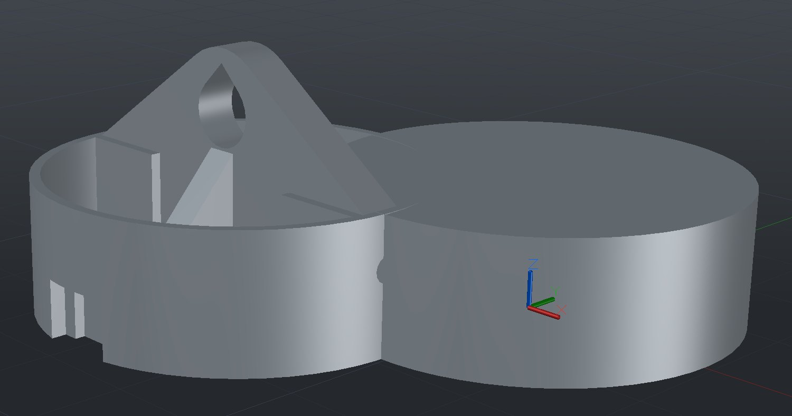
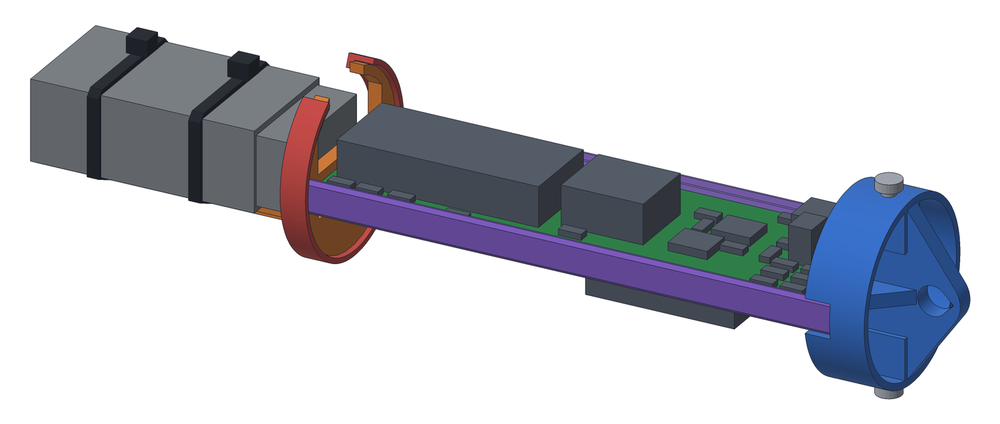
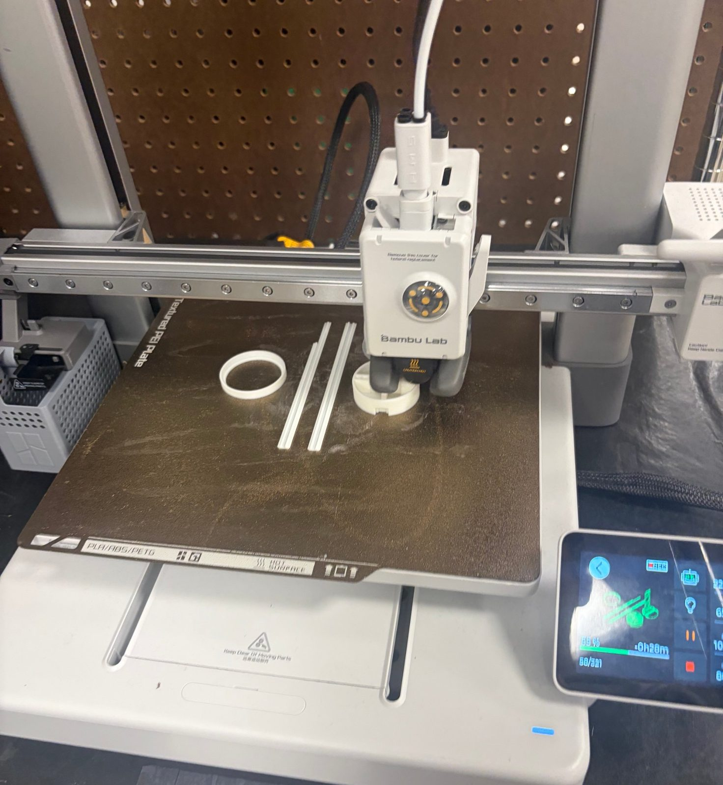
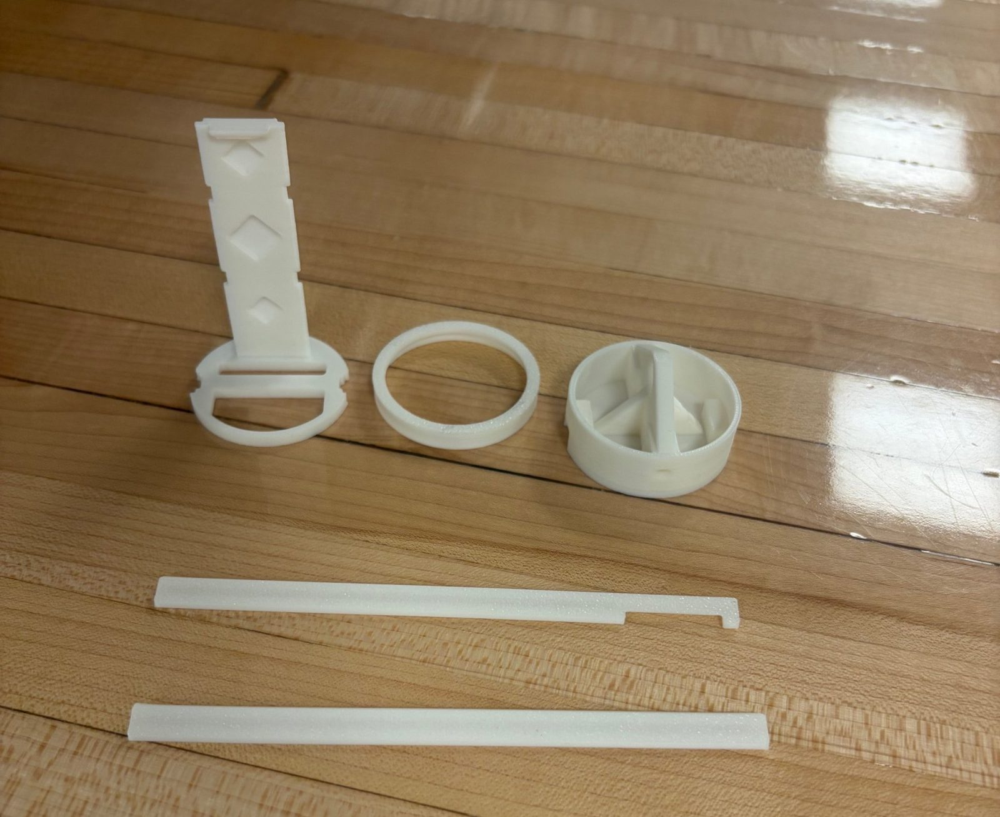
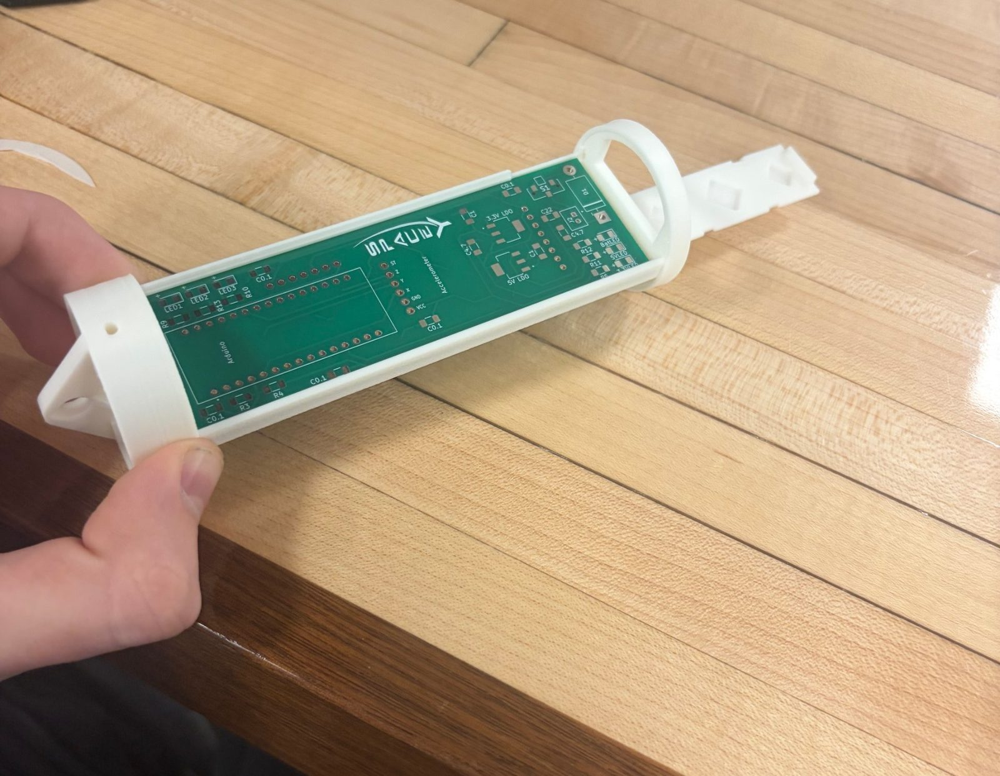
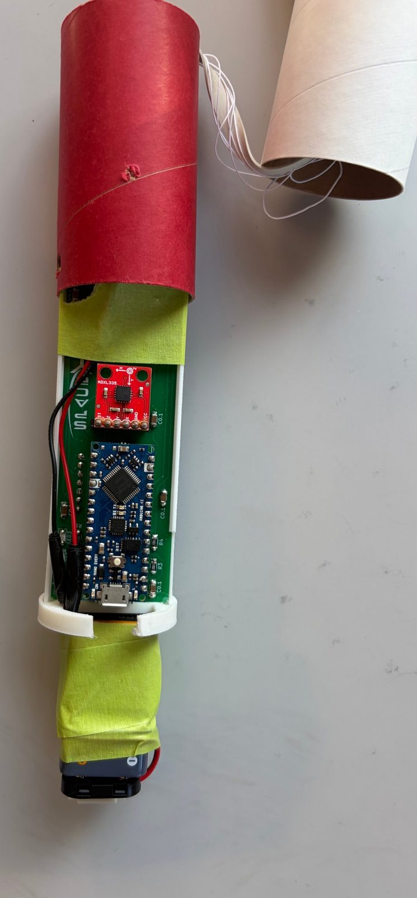
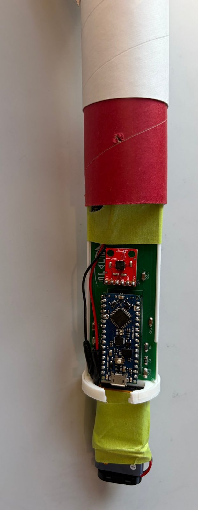
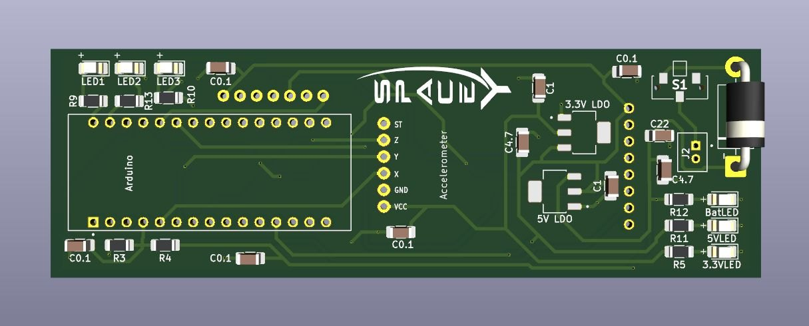
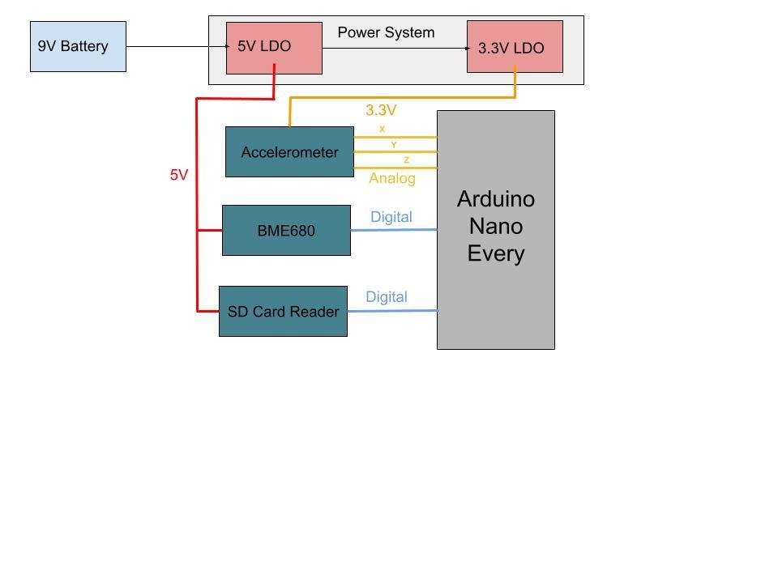

## Design

The preliminary design review placed the electronics inside a 3D-printed nose cone. The final design keeps a standard nose cone and moves the bay into a BT-60 payload tube, joined to the body tube with an Apogee AC-41.6 coupler. The sled slides in from the aft end, two M3 screws through the tube hold the bulkhead, and the stop ring keeps the sled from moving forward.



| Part | Job | Key detail |
|---|---|---|
| 1. Bulkhead | Closes the aft end, holds the rails, and anchors the shock cord | 39.1 mm diameter, sized for the coupler's 39.37 mm bore |
| 2a, 2c. Rails | Hold the board by its edges | 2c has a cut-out for the slide switch |
| 3. Cap and battery cradle | Joins the front ends of the rails and holds the 9 V battery | 14 mm USB notch, spine 1.4 mm thicker in Revision 2 |
| 4. Stop ring | Glued inside the tube. The cap presses against it so the sled can't move forward | 40.15 mm diameter, cut into a C-ring with a 16 mm USB notch |
| 5. Drill jig | Lines up the holes in the tube | 3.4 mm screw holes, 2.5 mm vents, 5 mm switch hole |

The flight parts weigh about 19 g in PLA. Every part was checked for interference in CAD against the catalog sizes of the tube and coupler before printing.

<figure style="flex: 1.9 1 0"><figcaption>Bulkhead in AutoCAD, with the shock-cord loop and rail slots</figcaption></figure>
<figure style="flex: 2.36 1 0"><figcaption>Revision 2 sled with the board and battery in place</figcaption></figure>

### Revision 2

The first printed set was dry-fit with the bare board. Because the board is hot-glued into the sled, Revision 2 is aimed at a bay that ships assembled. It keeps the printed geometry and changes three things:

- The slide switch cut-out moves to the opposite corner of the board, in rail 2c and in the drill jig
- The cap's spine is 1.4 mm thicker
- The cap and stop ring get matching notches, so a USB cable can reach the Arduino from the nose end with the nose cone off

## Build and test

<figure style="flex: 0.92 1 0"><figcaption>Printing on a Bambu Lab A1</figcaption></figure>
<figure style="flex: 1.22 1 0"><figcaption>The printed parts</figcaption></figure>
<figure style="flex: 1.29 1 0"><figcaption>Dry fit with the bare board</figcaption></figure>

The parts were printed in PLA at the U-M 3D Printing Club, at 0.20 mm layers with no supports.



The team ran these go/no-go tests before launch:

| Test | Method | Result |
|---|---|---|
| Bench | Board powered on the bench, checking that it logs data and the LEDs work | Pass |
| Spike, accelerometer | Board shaken along each axis | Pass |
| Spike, BME680 | A warm finger on the sensor for temperature, a breath on it for pressure | Pass |
| Pendulum | Board and battery mounted and swung on strings of different lengths | Pass |
| Elevator | Elevator ride with a stop at each level | Pass |
| Simulation | RockSim check of altitude and stability on the required motors | Pass |

<figure style="flex: 0.47 1 0"><figcaption>Finished sled with the coupler fitted</figcaption></figure>
<figure style="flex: 0.39 1 0"><figcaption>Coupler joined to the body tube</figcaption></figure>

## Flight simulation

The course requires a flight on a C11 followed by a flight on a D12. The team's RockSim model includes the bay and its electronics.





## Sensor board

The board runs from a single 9 V battery through 5 V and 3.3 V regulators. The ADXL335 accelerometer feeds the Arduino's analog inputs, and the BME680 and microSD logger connect digitally.

<figure style="flex: 2.48 1 0"><figcaption>The sensor board in KiCad's 3D viewer</figcaption></figure>
<figure style="flex: 1.33 1 0"><figcaption>Team block diagram from the design review</figcaption></figure>

## Next: the Smarter Flyer

The next phase of the course is a pitch for the **Smarter Flyer**, a kit built on the Hi-Flier XL for teens and anyone new to rocketry, engineering, or flight computers. It pairs a flight computer that records pressure, temperature, three-axis acceleration, and voltage with a modified rocket and an avionics bay that comes hot-glued and ready to fly. Revision 2 was drawn with that kit in mind, so the board can be reprogrammed without opening the bay.

## Links

- [ENGR 100-980 Rocket Science course site](https://980.engr100.org/)
