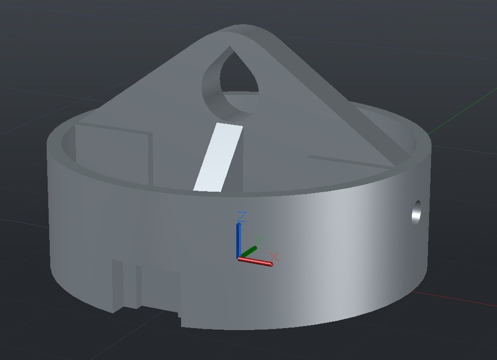
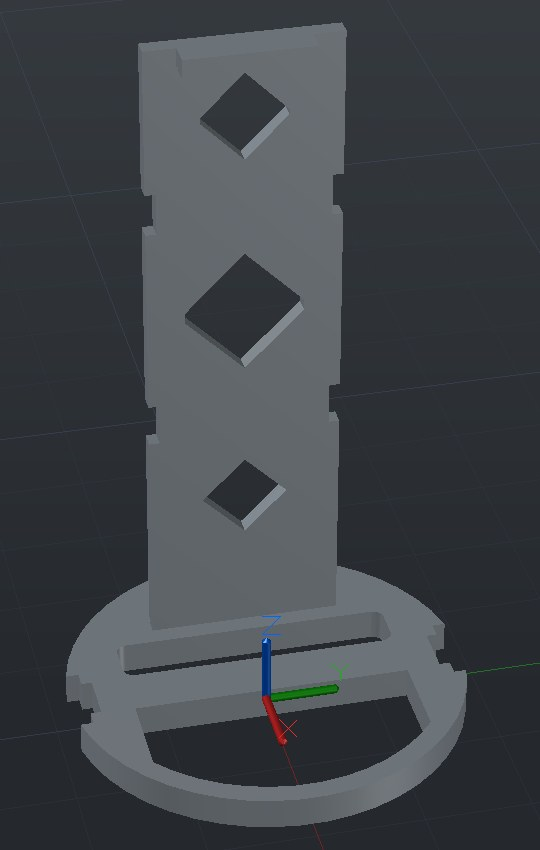
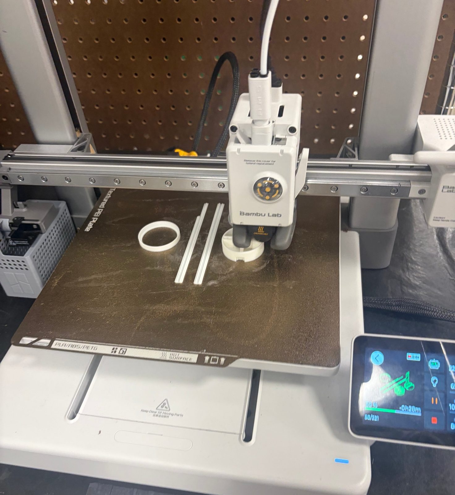
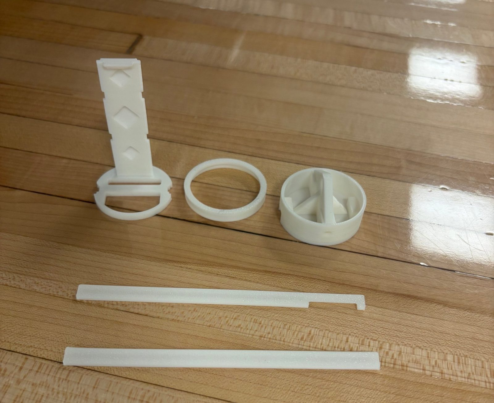
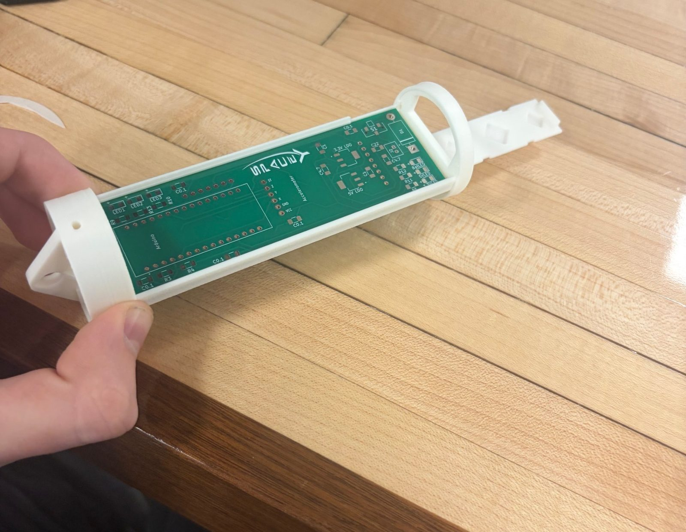
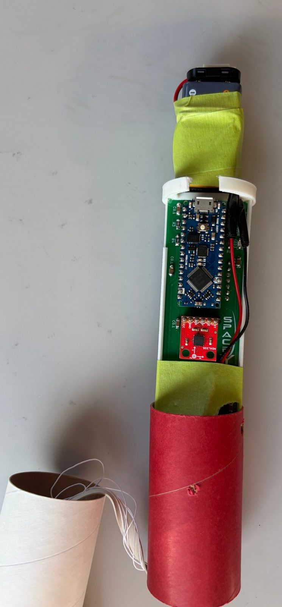
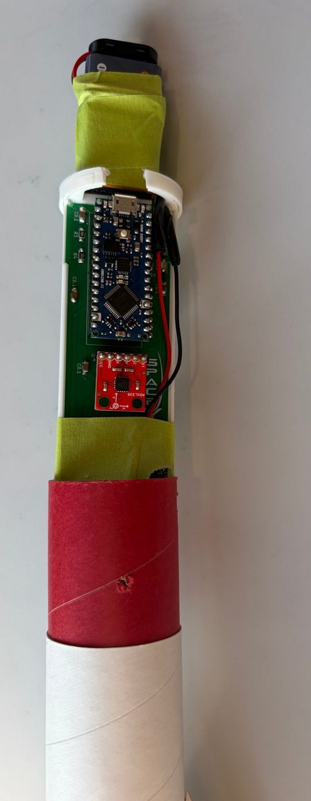
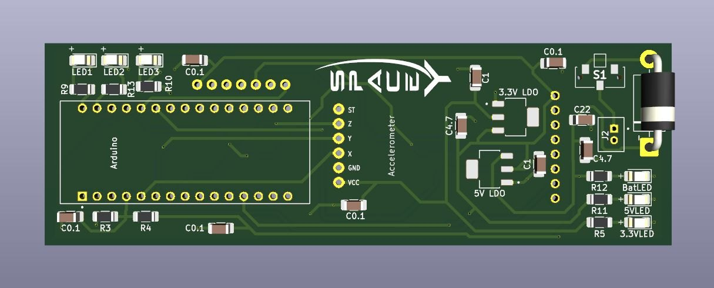
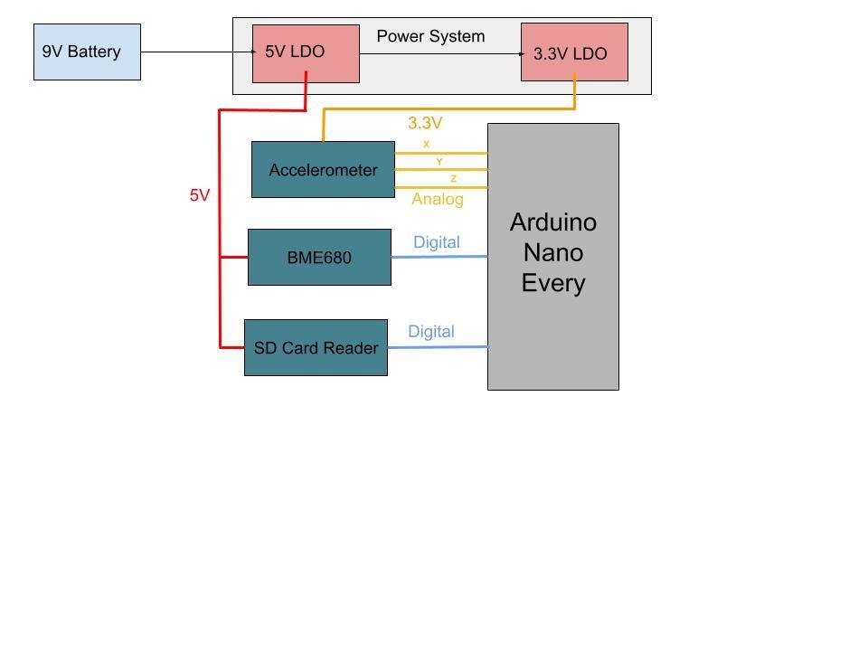

## Design

The preliminary design review placed the electronics inside a 3D-printed nose cone. The final design keeps a standard nose cone and moves the bay into a BT-60 payload tube, joined to the body tube with an Apogee AC-41.6 coupler. The sled slides in from the aft end, two M3 screws through the tube hold the bulkhead, and the stop ring keeps the sled from moving forward.



| Part | Job | Key detail |
|---|---|---|
| 1. Bulkhead | Closes the aft end, holds the rails, and anchors the shock cord | 39.1 mm diameter, sized for the coupler's 39.37 mm bore |
| 2a, 2c. Rails | Hold the board by its edges | 2c has a cut-out for the slide switch |
| 3. Cap and battery cradle | Joins the front ends of the rails and holds the 9 V battery | 14 mm USB notch, spine 1.4 mm thicker in Revision 2 |
| 4. Stop ring | Glued inside the tube. The cap presses against it so the sled can't move forward | 40.15 mm diameter, cut into a C-ring with a 16 mm USB notch |
| 5. Drill jig | Lines up the holes in the tube | 3.4 mm screw holes, 2.5 mm vents, 5 mm switch hole |

The flight parts weigh about 19 g in PLA. Every part was checked for interference in CAD against the catalog sizes of the tube and coupler before printing.

<figure style="flex: 1.38 1 0"><figcaption>Bulkhead in AutoCAD, with the shock-cord loop and rail slots</figcaption></figure>
<figure style="flex: 0.64 1 0"><figcaption>Cap and battery cradle in AutoCAD</figcaption></figure>

## Revision 2

The first printed set was dry-fit with the bare board. Because the board is hot-glued into the sled, Revision 2 is aimed at a bay that ships assembled. It keeps the printed geometry and changes three things:

- The slide switch cut-out moves to the opposite corner of the board, in rail 2c and in the drill jig
- The cap's spine is 1.4 mm thicker
- The cap and stop ring get matching notches, so a USB cable can reach the Arduino from the nose end with the nose cone off

## Build and test

<figure style="flex: 0.92 1 0"><figcaption>Printing on a Bambu Lab A1</figcaption></figure>
<figure style="flex: 1.22 1 0"><figcaption>The printed parts</figcaption></figure>
<figure style="flex: 1.29 1 0"><figcaption>Dry fit with the bare board</figcaption></figure>

The parts were printed in PLA at the U-M 3D Printing Club, at 0.20 mm layers with no supports.



The team ran these go/no-go tests before launch:

| Test | Method | What it checks | Result |
|---|---|---|---|
| Bench | Board powered on the bench | Power, status LEDs, and logging to the microSD card all work before anything moves | Pass |
| Spike, accelerometer | Board shaken along each axis in turn | Each of the three ADXL335 axes responds, on the right channel | Pass |
| Spike, BME680 | A warm finger on the sensor, then a breath on it | Temperature and pressure readings both react to a quick change | Pass |
| Pendulum | Board and battery mounted and swung on strings of different lengths | The logged swing follows the known motion, and the board and battery stay put while moving | Pass |
| Elevator | Elevator ride with a stop at each floor | Pressure, and the altitude worked out from it, step with each floor | Pass |
| Simulation | RockSim model with the bay on the required motors | Altitude and stability margin are acceptable on the C11-3 and D12-5 | Pass |
{: .tests}

<figure style="flex: 0.47 1 0"><figcaption>Finished sled with the coupler fitted, nose end up</figcaption></figure>
<figure style="flex: 0.39 1 0"><figcaption>Coupler joined to the body tube below</figcaption></figure>

## Flight simulation

The course requires a flight on a C11 followed by a flight on a D12. The team's RockSim model includes the bay and its electronics.





RockSim flags both configurations as overstable. The usual target is 1 to 2 calibers, and a higher margin makes the rocket weathercock, turning more into the wind after it leaves the rod. For low, slow flights like these, 3.45 to 3.64 calibers is acceptable.

## Sensor board

The board runs from a single 9 V battery through 5 V and 3.3 V regulators. The ADXL335 accelerometer feeds the Arduino's analog inputs, and the BME680 and microSD logger connect digitally.

Helping design this board and lay it out in KiCad is what sparked the interest in flight computers that led to [Kestrel](/projects/kestrel/). Along the way, teams peer-reviewed each other's boards, checking another team's design and getting feedback on their own. All of the programming was done in the Arduino IDE, first in the course's earlier labs and then for this board's flight code, which reads each sensor and logs the data to the microSD card.

<figure style="flex: 2.48 1 0"><figcaption>The sensor board in KiCad's 3D viewer</figcaption></figure>
<figure style="flex: 1.33 1 0"><figcaption>Team block diagram from the design review</figcaption></figure>

## Next: the Smarter Flyer

The next phase of the course is a pitch for the **Smarter Flyer**, a kit built on the Hi-Flier XL for teens and anyone new to rocketry, engineering, or flight computers. It pairs a flight computer that records pressure, temperature, three-axis acceleration, and voltage with a modified rocket and an avionics bay that comes hot-glued and ready to fly. Revision 2 was drawn with that kit in mind, so the board can be reprogrammed without opening the bay.
